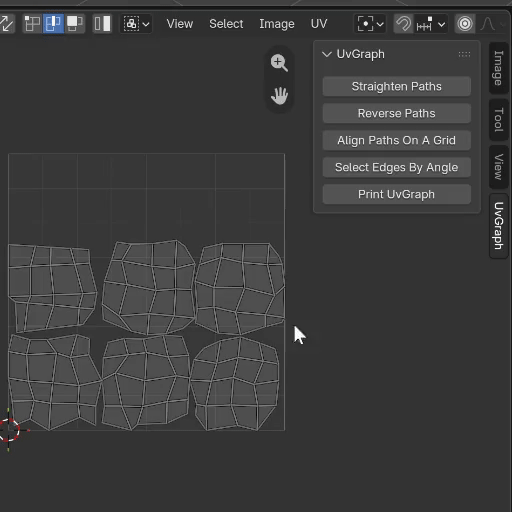

# TohmUVManip-Blender

> [!WARNING]
> Work in progress, may be buggy.

## Status

Very useful to me right now (Oct 2026) for basic operations like `Straighten Paths`, but not reliable: real bugs exist and may come back.

## In a few words

This add-on relies mostly on an included graph class, `UvGraph`, which models the current UV selection as connected graphs (paths, rings, trees, etc.) so that it can be manipulated based on **visual items, coordinates and connections** in the UV Editor.
- **Items**: path, mesh island, tree, graph, etc.
- **Coordinates**: several vertices/loops at the same location in the UV Editor are treated as a single point (`UvVert`).
- **Connections**: operations work on the current selection, specifically on selected edges in the UV Editor forming a path.

## Requirements

- Blender 5.x

## Selection modes

`UV Sync Selection`, `Sticky Selection Mode` and the UV `Select Mode` interact in complicated ways. Depending on the current state of the project, they may need to be set to specific values; the UI tells you when a setting needs to be changed.

Properly handling them is a goal for the official release.

## Support & feedback

Provided as is, with no support. Happy to discuss the ideas and the code (graph model, UV selection in Blender 5.x, design choices).